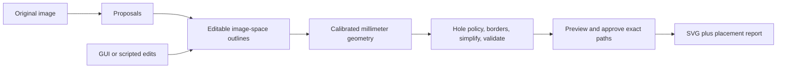

# Parser and review

The parser, reversible editor, optional SAM selection, and approved-path SVG export are implemented. The desktop GUI composes these with the existing gphoto2 capture service; each phase also works independently. See the [README](../README.md#review-sticker-regions) for installation and commands. No camera is needed for parsing, editing, calibration interfaces, or export.

## Recognition choice

**SAM 2.1 Hiera Small** is the initial interactive backend, with **OpenCV** for quick panel proposals and **Shapely** for deterministic cut geometry. This choice has an initial laptop experiment behind it, not a representative quality benchmark.

| Tool | Responsibility and evidence |
| --- | --- |
| SAM 2.1 | Its [image predictor](https://github.com/facebookresearch/sam2/blob/main/sam2/sam2_image_predictor.py) supports box/foreground/background prompts and cached features. The adapter caches full-resolution crop features, retains prior mask logits for additional clicks, and saves mask/prompt/checkpoint provenance. |
| OpenCV | [Contours and polygon approximation](https://docs.opencv.org/4.x/d3/dc0/group__imgproc__shape.html) supply bounded panel proposals from a smaller processing image, with transforms back to the primary raster. Interior-variation filtering reduces empty mat-grid proposals; duplicates are suppressed while useful nested alternatives remain. |
| Shapely | Pixel-cell boundary tracing preserves holes, isolated pixels, and diagonal contacts without invalid contour repairs. [Buffers](https://shapely.readthedocs.io/en/stable/reference/shapely.buffer.html), booleans, and bounded simplification produce cut paths. |

SAM 2 supports native MPS/CPU. The modern stack uses Metal on Apple silicon; the Intel Ventura configuration uses locked legacy Torch on CPU, validated for this pinned image API through Rosetta. See [runtime decisions](system-design.md#runtime-and-transfer) for the build/dependency exception. CUDA is disabled; the application traces masks itself. Jobs record source revision, checkpoint SHA-256, Torch version, device, prompts, crop, mask checksum, and timings. `models fetch` downloads/verifies official weights once, and the adapter verifies them before loading. Ordinary use is offline. Capture/calibration and edit/geometry tests do not require Torch, Qt, or OpenCV.

SAM 3 adds [text/exemplar selection](https://github.com/facebookresearch/sam3), but its current official setup requires CUDA and [Apple/CPU support remains an open contribution](https://github.com/facebookresearch/sam3/pull/627). Reconsider it if deployment support or project needs change. OCR could label suggestions; it does not define sticker backing. Model confidence never approves cuts.

## Editing behavior

The sample's icon panels, bottom label, and headline represent different intentions: an entire panel, an illustration silhouette, or backing around disconnected letters. Fixed mounting and LED fill improve the photo; the user still chooses the intended sticker.

- **Work area:** restrict proposals to the paper. Existing out-of-area suggestions are hidden; included regions remain visible with bounds diagnostics.
- **Add/correct:** AI boxes and foreground/background clicks create alternatives. Manual rectangles, rounded rectangles, polygons, freehand, vertex moves, and add/erase brushes remain available. Split with a line or separate disconnected components.
- **Accept/remove/reset:** proposals never overwrite chosen outlines. Accepting refinement explicitly replaces its ancestor selection and inherits its recipe; undo restores it. Show/restore removed regions or reset to the original proposal outline.
- **Group/union/backing:** grouping preserves separate cuts. Union merges overlaps and retains disjoint components. One backing explicitly encloses artwork in a rectangle; the API also supports a deliberately requested hull. Never silently bridge letters or convex-hull a selection.
- **Borders/shape:** grow/shrink, round/mitre/bevel corners, bounded simplification, and explicit inner cuts. Recipes recompute from the base outline rather than repeatedly dilating a raster. Mixed recipes need an explicit resulting recipe when combining. Artwork stays at its photographed position.
- **Undo/save:** bounded undo/redo persists across sessions. Atomic autosave uses a sidecar lock and detects changed files; Save as recovers edits to a new file after a conflict. Display zoom/rotation never changes geometry.

The PySide6 editor provides a [zoomable graphics view](https://doc.qt.io/qtforpython-6/PySide6/QtWidgets/QGraphicsView.html), region list, shape controls, diagnostics, and standard undo shortcuts. It holds one source raster; tiled loading is future work if larger inputs warrant it. A persistent background process retains model caches, permits analysis cancellation, and rejects stale job/revision results. Manual editing stays available during analysis. Camera capture finishes under its existing deadline before switching jobs/closing; cancellation never kills a camera transfer.

## Geometry and approval

Coordinates use the unrotated primary raster, including frame zero of Sony MPO files. Resized/cropped processing retains its transform. SAM resizes each crop internally; full-resolution output does not establish edge accuracy. Mask tracing uses at most 0.35 px simplification deviation, separate from model accuracy.

Map into millimeters before physical offsets/tolerances: uniform pixel dilation cannot represent a uniform physical border under perspective. Map the edited outline, apply hole policy (outer cuts by default), buffer, simplify within the requested deviation, then validate. Round-buffer arcs approximate within 0.02 mm or 0.2 px. Lens correction is not implemented: current image jobs are raw, and undistorted profiles are rejected as incompatible. Future lens correction must precede mat mapping.

Uncalibrated content review and pixel previews work completely. Millimeter borders/tolerances remain pending rather than using a guessed scale. [Calibration compatibility and measured validation](calibration.md#shared-api) gate physical approval; synthetic profiles support mathematical previews/tests only.

Diagnostics cover invalid/empty paths, component/hole topology changes, overlapping/shared cuts, sheet/mat bounds, and optional minimum feature/clearance constraints in millimeters. Material limits are configurable through the command API; zero disables those checks. Warnings need acknowledgment; errors block approval. No silent clipping or topology repair occurs. Growth includes existing paper; it cannot create an absent white border.

Physical approval requires selected regions marked reviewed and stores the exact millimeter snapshot. Source, revision, recipe, calibration, and path fingerprints bind approval; every edit/undo/redo invalidates it. SVG serializes those vertices without recognition, rebuilding, scaling, or rounding, and includes a placement report. Design Space sizing/Attach/absolute placement and blade alignment remain physical acceptance checks.

## Document and service contracts

`regions.json` schema version 1 contains:

| Record | Contents |
| --- | --- |
| Source | Path, SHA-256, primary frame, raster dimensions, EXIF orientation, pixel/lens frame. Identical relocated bytes preserve identity. |
| State | Work area; stable region IDs, labels, Polygon/MultiPolygon, baseline, provenance, recipe, proposed/selected/rejected status and content review; groups; embedded calibration; feature/clearance limits. |
| History | Up to 40 snapshots in each undo/redo direction. Revisions increase even after undo, preventing old inference from becoming current again. |
| Approval | Input fingerprint, exact millimeter paths/diagnostics, profile ID/mat size, snapshot fingerprint. Content review differs from physical approval. |

Masks are cropped PNG assets with origins/checksums, outside inline JSON. Geometry reopens without weights/inference. Image paths are relative to the saved document; legacy paths can be hash-checked and rebound. `regions bundle` copies image/masks/history into a portable folder and clears physical approval on the copy. Keep photos and generated jobs/assets under ignored `data/`/`output/`; none is a prerequisite for a fresh clone, which can generate a software test sheet.

Shared APIs outside CLI/GUI code:

- [regions.py](../src/sticker_maker/regions.py): `RegionDocument.create/load/save`, `apply(command, expected_revision=...)`, `undo/redo`, `approve`, `approved_snapshot`.
- Commands: `add`, `proposals`, `select/accept/reject/review/reset`, `replace`, `recipe`, `brush`, `union/backing/split`, `group/ungroup`, `work_area`, `calibration`, `constraints`, `undo/redo`. Outlines are GeoJSON; `ids` addresses regions. `regions edit --command` accepts a command or an atomic-on-save batch.
- [geometry.py](../src/sticker_maker/geometry.py): `build_cut_paths(document, physical=False)` supplies preview/approval paths, units, profile context, and diagnostics.
- [recognition.py](../src/sticker_maker/recognition.py): `OpenCVRecognizer.propose`, `parse_image`, `save_overlay`; [sam.py](../src/sticker_maker/sam.py): `SAMRecognizer.refine`. Results carry source identity; GUI tasks also carry job/revision IDs.
- [export.py](../src/sticker_maker/export.py): `export_svg` consumes approved artifacts without camera/model access. Archived snapshots work without the original image; if present, its identity is checked.

## Evidence and next checks

On the Apple M4 / 16 GB laptop, the handheld example's first OpenCV pass found the four panels and bottom label but included mat-grid cells. Interior filtering reduced 60 suggestions to 15 over the full photograph; restricting the work area further excludes desk/mat distractions. One pass took about 0.32 s after OpenCV import, including decoding/hash work. This is not an end-to-end percentile.

One mask-panel box, ten warm repetitions per model, separate MPS processes:

| SAM 2.1 model | Warm refinement p95 | First refinement after model load | Peak process RSS |
| --- | --- | --- | --- |
| Small | 28 ms | 0.85 s | 1.31 GB |
| Tiny | 168 ms | 0.70 s | 1.24 GB |

Small produced one clean region; Tiny's raw mask had 43 components, increasing tracing work. Outer-cut policy can fill internal holes/islands. This favors Small initially, not as a general ranking. Model setup ranged from about 1.1 s with cached imports/files to 4.8 s initially; first-use GPU compilation affects startup. Small's CPU fallback completed at 1.03 s first refinement and approximately 34 ms warm in two trials. RSS excludes GPU allocations. Detailed prompts, hashes, timings, masks, and logs remain local artifacts under `output/parser-sample/`.

Tests cover camera/model-independent edit/geometry contracts, optional OpenCV proposals, offscreen drawing/selection/vertices/borders/undo, stale results, and capture completion handling. A separate cached-model GUI test verifies real background box/click refinement. SVG tests compare serialized vertices exactly to the approved snapshot. No camera was accessed during parser development; a new live GUI capture remains a hardware follow-up.

Next, annotate intended backing on 10–20 varied sheets. Compare manual tracing, OpenCV proposals, and SAM-assisted review using misses/distractors, component/hole errors, corrections/time to approval, and boundary deviation. Use pixels until measured calibration permits millimeters. Include labels versus silhouettes, grouped text, adjacent artwork, fine features, low contrast, and glare; add mounted/LED examples later. Bounded automatic SAM discovery and natural-language commands are future enhancements if evidence justifies them. Acceptance targets remain in the [roadmap](roadmap.md).
