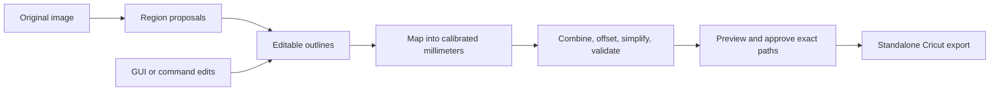

# Parser and review strategy

This is the implementation strategy; recognition, editing, and export are not implemented yet. Parsing must work on saved images without a camera or final rig calibration. The review editor belongs in this milestone so interaction can guide parser development; the combined capture-to-export application comes later.

## Recognition choice

Start with **SAM 2.1 Hiera Small for interactive segmentation**, **OpenCV for simple proposals and contour extraction**, and **Shapely for cut geometry**. This is a fit recommendation, not a measured quality or speed result. Benchmark Small against Tiny on the available Apple M4 with 16 GB memory before fixing the default checkpoint.

| Option | Fit and decision |
| --- | --- |
| SAM 2.1 | Its [image predictor](https://github.com/facebookresearch/sam2/blob/main/sam2/sam2_image_predictor.py) caches image features and accepts foreground/background points, a box, and previous mask predictions. These map directly to adding and correcting selections. Use as the initial recognition backend. |
| OpenCV alone | [Contours, connected components, and polygon approximation](https://docs.opencv.org/4.x/d3/dc0/group__imgproc__shape.html) suit framed labels and provide a cheap baseline. Use for quick first proposals and full-resolution edge processing; evaluate its limits on irregular artwork. |
| SAM 3 / 3.1 | [Text/exemplar concept selection](https://github.com/facebookresearch/sam3) is attractive for future discovery. The official setup currently requires CUDA and checkpoint access approval; [Apple/CPU support is still an open contribution](https://github.com/facebookresearch/sam3/pull/627). Its deployment cost makes it a poorer initial fit for this Mac. Keep recognition replaceable. |

SAM 2's [official demo supports native MPS and CPU](https://github.com/facebookresearch/sam2/blob/main/demo/README.md), with performance caveats. Run natively on macOS; benchmark MPS and retain a slower CPU fallback. Its [CUDA extension can be omitted](https://github.com/facebookresearch/sam2/blob/main/INSTALL.md); perform required contour cleanup in our geometry pipeline. Keep recognition dependencies optional so capture/calibration and core tests do not require PyTorch. Pin the tested package revision, compatible Torch stack, checkpoint hash, and device configuration. Download weights once; ordinary use should then work offline.

No custom training is required for the first experiment. OCR may later help label suggestions, but recognizing words does not define sticker backing. Model confidence ranks proposals; it never approves cuts.

## Review workflow

The sample's icon panels, “HANDLE WITH CARE” label, and “FRAGILE CHINA” headline exercise different intentions: keep a panel, trace an illustration, or surround several disconnected letters. Better mounting and LED lighting improve image quality; choosing the intended sticker remains an editing task.

1. Open a saved photograph or completed capture. Define the sheet/work area to exclude desk objects and mat markings; show fast panel proposals while segmentation continues. Seed SAM with panel boxes; evaluate a bounded [automatic mask pass](https://github.com/facebookresearch/sam2/blob/main/sam2/automatic_mask_generator.py) for irregular artwork inside the work area. Limit resolution, sampling, and candidate count; filter duplicates while preserving useful nested alternatives.
2. Select proposals on a zoomable image or region list. Offer panel/label, silhouette, and enclosing-backing choices rather than committing to one interpretation.
3. Add, correct, combine, and style selected regions. Show the base selection and resulting cut line separately, including all disconnected components.
4. Review diagnostics and approve the exact final paths. Save/reopen the job without running recognition again; export consumes that approved geometry.

| Control | Required behavior |
| --- | --- |
| Add / remove | Box or foreground click to add; background clicks to exclude unwanted areas. Reject/restore proposals. Manual rectangle, rounded rectangle, polygon, and freehand fallback always remain available. |
| Correct / split | Move vertices; brush-add/erase selection; split by drawn line or connected components. Reset a region to its proposal without losing other edits. |
| Group | Select and adjust several stickers together while retaining separate cut paths. |
| Union | Merge overlapping regions. Disconnected inputs remain multiple components; a [geometric union](https://shapely.readthedocs.io/en/stable/reference/shapely.union_all.html) does not create connecting paper. |
| One backing | Explicitly enclose disconnected artwork with an editable outline or deliberate bridge. Preview the added paper; never silently turn a whole selection into a convex hull. |
| Border / shape | Numeric grow/shrink, rounded joins by default, adjustable corner treatment, bounded smoothing/simplification, and optional inner cuts. Project defaults plus per-region overrides; default to outer boundaries only. |
| Undo / save | Every edit supports undo/redo, including merges and deletions. Autosave atomically, restore the current document, and retain bounded undo history. |

Borders are non-destructive recipe values recomputed from the edited base outline, rather than repeated raster dilation. Changing a border from 2 mm to 3 mm must not degrade the original contour. Combining regions with different styles requires an explicit resulting style. Keep artwork fixed in its photographed position; layout packing would misalign cuts on the original sheet.

## Geometry and approval

Convert masks to editable polygons while retaining proposal masks as provenance. Refinement uses original-resolution crops with explicit crop/resize transforms; upsampling a coarse whole-image mask does not establish edge accuracy. Preserve hand edits when proposing a replacement.

Map geometry into the calibration's pixel space and then millimeters **before** physical offsets and tolerances. A uniform pixel dilation is not a uniform physical border under perspective. Apply hole/combination policy, [Shapely positive/negative buffers](https://shapely.readthedocs.io/en/stable/reference/shapely.buffer.html), and bounded simplification in a documented order. Lens correction, when implemented, must precede mat mapping; densify contours as needed for nonlinear transforms. Use the [calibration compatibility and measured-validation checks](calibration.md#shared-api).

Without calibration, allow complete image-space review and clearly labeled pixel previews. Store desired millimeter borders as pending values; physical path approval waits for a validated transform. Synthetic fixtures can test geometry independently but cannot authorize photo-derived cuts.

Validate self-intersections, empty/shrunken regions, unintended components/holes, narrow bridges, duplicate/overlapping cuts, clearance, and sheet/mat bounds. Unexpected topology changes require review; do not silently repair or clip them. Feature/clearance limits depend on the eventual material stack. Outward growth includes existing surrounding paper; it cannot create an absent white border.

The preview and SVG must use the **same derived path snapshot**, including approximation tolerances. Bind export approval to source identity, region revision, calibration fingerprint, recipe, and final-geometry hash. Any change to those inputs invalidates approval. Export checks approval and validation without rerunning segmentation or independently rebuilding outlines. Physical cutter placement remains a separate validation step.

## Saved document and API boundaries

Use versioned `regions.json` with stable region IDs and explicit document revisions:

| Record | Retain |
| --- | --- |
| Source/frame | Image SHA-256, primary frame index, raster dimensions, original EXIF orientation, raw/undistorted pixel space, and every preview/crop transform. Follow the calibration convention: unrotated primary raster coordinates. |
| Proposals | Provider/checkpoint/settings, prompts, scores, cropped mask asset references/checksums, parent/alternative relationships. Avoid hundreds of full-size masks in memory or inline JSON. |
| Edited regions | Authoritative Polygon/MultiPolygon outlines, provenance, inclusion/review state, groups, and reversible edit commands. A model rerun produces alternatives and never overwrites edited regions. |
| Cut recipe | Combination/hole policy, offset units/value, corner style, simplification tolerance, calibration ID, and physical-validation state. |
| Approved output | Exact millimeter path snapshot, diagnostics, input/geometry fingerprints, and approval revision. Uncalibrated content review is distinct from physical export approval. |

Keep four services outside CLI/GUI code: recognition (`prepare`, `propose`, `refine`); document editing (`apply_command`, undo/redo, save/load); geometry (`build_cut_paths`, diagnostics); and approval. These are proposed interfaces, not existing commands. A standalone parsing entry point accepts an image path; editing is also scriptable for deterministic tests. Export accepts the saved reviewed artifact without a camera or recognition model.

Use **PySide6** for the desktop editor: a [graphics view](https://doc.qt.io/qtforpython-6/PySide6/QtWidgets/QGraphicsView.html) with zoom/pan and overlays, a region list with review states, and a selected-region inspector with border controls. Adapt [Qt undo actions](https://doc.qt.io/qtforpython-6/PySide6/QtGui/QUndoStack.html) to the shared edit commands rather than implementing a second editor model.

Run recognition in a background worker with progress/cancel and one active model to bound memory. Cache image/crop features, load detailed image tiles on demand, and reject stale results using source/job/revision IDs. The editor must remain usable during loading, inference, cancellation, or provider failure. Future natural-language requests can translate into the same typed edit commands; direct controls come first.

## Implementation and evidence

Build in this order:

1. Region document/edit commands and deterministic geometry, using manual selections and a fake recognizer. Establish save/reopen, undo, revision checks, and physical approval behavior first.
2. OpenCV proposals and a thin review GUI; use the sample's panels and headline to validate editing semantics early.
3. SAM 2.1 Small/Tiny adapter and local benchmark; integrate click/box refinement and crop processing. Freeze the default only after comparing correction effort, edge quality, latency, and peak memory.
4. Approved-artifact export, then compose capture/review/export in the full GUI. Follow [roadmap registration checks](roadmap.md) before relying on physical cuts.

Start with the handheld example and accumulate 10–20 varied sheets, adding mounted/LED captures later. Annotate intended backing outlines, including labels versus silhouettes, grouped text, adjacent artwork, holes, fine features, low contrast, and glare. Compare OpenCV alone with SAM-assisted review against manual tracing. Measure missed/distracting proposals, component/hole errors, corrections and time to approval, boundary deviation, and memory. Use pixels until measured calibration permits millimeter comparisons. Report cold model/image setup separately from warm click refinement and full-resolution crop work.

Initial unmeasured goals: visible selection/undo feedback within 100 ms, first cheap proposals within 1 second of file readiness, and warm click refinement at p95 within 1 second. Measure these on the actual laptop; slower inference must not block editing. The combined capture-to-first-preview target stays in the roadmap and requires its own end-to-end measurement.

Acceptance includes adding a missed panel, rejecting a false region, subtracting unwanted content, splitting, distinguishing group/union/one-backing on disconnected letters, changing borders, undoing, and reopening identical paths. Automated fixtures must cover projective millimeter offsets, holes, disconnected unions, empty negative buffers, collisions/bounds, simplification error, stale inference, and approval invalidation. Test edit/geometry contracts without camera/model dependencies; keep model integration and visual benchmarks separate. No recognition model has yet been run on the sample, and neither segmentation precision nor GUI latency is established.
